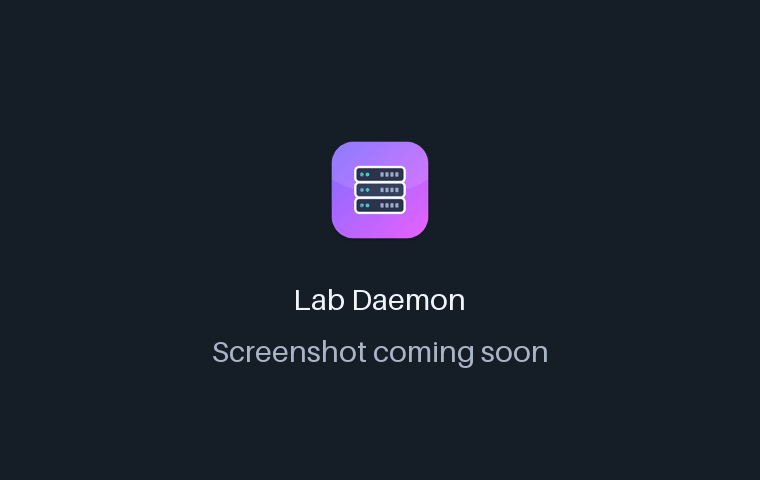
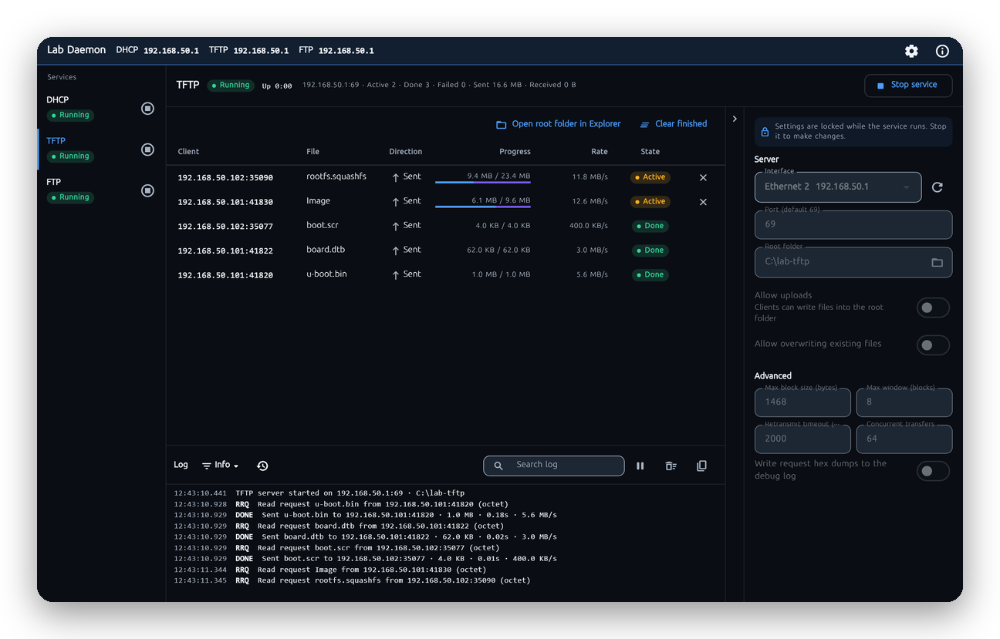
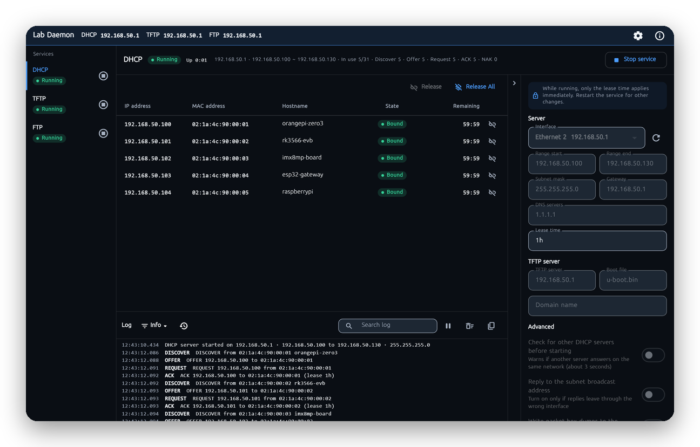

<!-- From jejezz/application-release-templates common/tool/readme @ conventions-v1.
     구성과 규칙: conventions/readme-guide.md, 검사: tool/readme/check_readme.py. -->

<p align="center">
  
</p>

<h1 align="center">Lab Daemon</h1>

<p align="center">
  랩 환경을 위한 <b>Windows 네트워크 서비스 실행기</b> — DHCP, TFTP, FTP 서버를 함께 켜고 Lease·전송·로그를 실시간으로 확인합니다.
</p>

<p align="center">
  <a href="https://github.com/jejezz/lab-daemon-flutter/releases/latest"></a>
  <a href="https://github.com/jejezz/lab-daemon-flutter/releases"></a>
  
  
  <a href="LICENSE"></a>
</p>

<p align="center">
  <a href="README.md">English</a> · <b>한국어</b>
</p>

<p align="center">
  
</p>

## 기능

- **DHCP 서버** — 정한 범위(서브넷, 게이트웨이, DNS, 임대 시간)에서 주소를 나눠 주고 DISCOVER/OFFER/REQUEST/ACK, NAK, RELEASE, DECLINE, INFORM을 처리합니다. 보드가 어디서 부팅할지 알려 주고(옵션 66/67), Lease 표에서 한 번에 해제할 수 있습니다. 켜기 전에 같은 망의 다른 DHCP 서버를 찾아 경고합니다.
- **TFTP 서버** — RFC 1350에 블록 크기·시간 제한·전송 크기 옵션(RFC 2347~2349)과 윈도 크기(RFC 7440), netascii, 선택 업로드를 지원합니다. 20MB 이미지를 loopback에서 초당 약 13~20MB로 보냅니다.
- **FTP 서버** — 계정 하나와 선택 익명 로그인(계정별 권한 설정 없음), 패시브(PASV/EPSV)·액티브(PORT/EPRT), 이어받기, FileZilla 같은 클라이언트용 목록을 지원합니다. 비밀번호는 솔트 해시로만 저장합니다.
- **클라이언트 현황을 실시간으로** — 서비스마다 따로 설정, 클라이언트 표(Lease·전송·세션과 속도), 로그(100~5000줄)가 있고, 앱 바에 클라이언트가 접속할 주소가 나옵니다. 요청이 쏟아져도 로그와 표가 가볍게 유지됩니다.
- **시작할 때 점검** — 서비스를 켤 때 포트 충돌, Windows 방화벽 허용 규칙 없음(Windows 버전에 맞춘 단계별 안내, 복사할 `netsh` 명령, 한 번에 추가), Windows가 예약한 포트를 확인합니다.
- **라이트·다크, 색 구성, 한국어·English** — 시스템 설정을 따르거나 설정에서 고를 수 있고, 글자 크기도 조절할 수 있습니다

<p align="center">
  
  
</p>

## 설치

[**Releases**](https://github.com/jejezz/lab-daemon-flutter/releases/latest)에서 받습니다.

| OS | 파일 |
|---|---|
| Windows 10/11 (x64) | `LabDaemon-<버전>-windows-x64-setup.exe` |

**Windows:** 설치 프로그램에 아직 코드 서명이 없어서 SmartScreen이 "Windows의 PC 보호" 창을 띄웁니다. **추가 정보 → 실행**을 누르세요.

앱은 일반 권한으로 실행하며, UDP 67/69와 TCP 21을 열 때 관리자 권한이 필요 없습니다. 관리자 권한으로 도는 설치 프로그램이 Windows 방화벽 인바운드 규칙을 넣어 줍니다. 다른 위치에서 실행한 복사본(개발 빌드 등)은 서비스를 켤 때 해결 방법 안내와 한 번에 규칙을 넣는 단추가 나옵니다.

**빠른 시작:** 사이드바에서 서비스를 고르고, 오른쪽 설정 패널에서 폴더(TFTP·FTP)나 주소 범위(DHCP)를 정한 뒤 **서비스 시작**을 누릅니다. 클라이언트는 앱 바에 나오는 주소로 접속하며, 포트는 프로토콜 기본값(TFTP 69, FTP 21)이 아닐 때만 표시됩니다.

> **DHCP:** 직접 관리하는 망에서만 켜세요. DHCP 서버가 둘이면 기존 서버가 방해받을 수 있습니다. 켜기 전에 다른 서버가 있는지 확인하지만, 전용 스위치를 쓰는 실험대에서 쓰는 것이 안전합니다.

## 동작 방식

서비스마다 자기 Dart Isolate에서 돌아서 패킷이 쏟아져도 화면이 막히지 않고, Isolate는 패킷마다 메시지를 보내는 대신 100ms마다 이벤트를 한 묶음으로 화면에 보냅니다(스냅샷은 최신 것만, 로그는 묶음마다 상한). Windows에서는 OS 버퍼가 차면 `RawDatagramSocket.send`가 패킷을 조용히 버리기 때문에, 모든 UDP 응답을 소켓이 쓸 수 있을 때 다시 보내는 전송 큐를 거칩니다. TFTP와 FTP는 루트 폴더 밖으로 나갈 수 없습니다(`..`, 드라이브 문자, 대체 데이터 스트림, 링크 탈출 차단).

## 개발

```bash
flutter pub get
flutter run -d windows
```

Windows 데스크톱을 지원하는 Flutter 3.47이 필요합니다(Visual Studio의 "C++를 사용한 데스크톱 개발" 워크로드). 검사는 `flutter analyze`와 `flutter test`로 합니다. 앱은 Skia로 그리며, Impeller를 써 보려면 `--enable-impeller`(또는 환경 변수 `LABDAEMON_IMPELLER=1`)를 붙입니다.

구조와 결정: [ARCHITECTURE.md](ARCHITECTURE.md), 계획: [PLAN.md](PLAN.md).

릴리스: `scripts/bump-version.sh patch` → 병합 → `vX.Y.Z` 태그. CI가 모든 플랫폼을 빌드해서 올립니다. 규칙: [application-release-templates/conventions](https://github.com/jejezz/application-release-templates/tree/main/conventions).

## 크레딧

- 글꼴: [서울남산체](https://www.seoul.go.kr/seoul/font.do) (서울특별시)
- 아이콘: [Icons8](https://icons8.com)

## 라이선스

[MIT](LICENSE) © 2026 Jongyun Ahn
