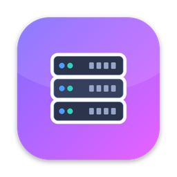
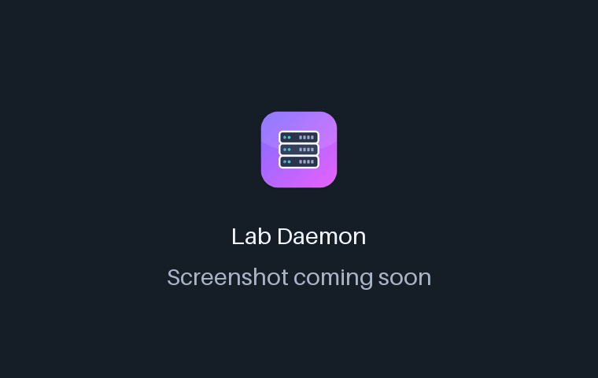
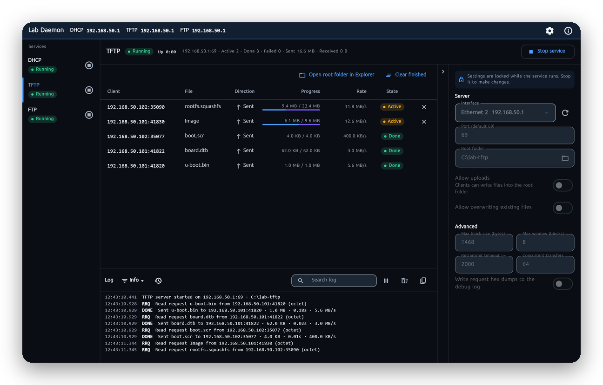
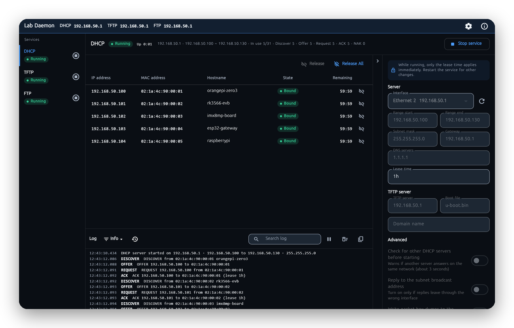

<!-- From jejezz/application-release-templates common/tool/readme @ conventions-v1.
     Structure and rules: conventions/readme-guide.md; checked by tool/readme/check_readme.py. -->

<p align="center">
  
</p>

<h1 align="center">Lab Daemon</h1>

<p align="center">
  A <b>lab network service launcher for Windows</b> — run DHCP, TFTP, FTP and HTTP servers side by side and watch every lease, transfer and log line live.
</p>

<p align="center">
  <a href="https://github.com/jejezz/lab-daemon-flutter/releases/latest"></a>
  <a href="https://github.com/jejezz/lab-daemon-flutter/releases"></a>
  
  
  <a href="LICENSE"></a>
</p>

<p align="center">
  <b>English</b> · <a href="README.ko.md">한국어</a>
</p>

<p align="center">
  
</p>

## Features

- **DHCP server** — hands out addresses from a range you set (subnet, gateway, DNS, lease time) with DISCOVER/OFFER/REQUEST/ACK, NAK, RELEASE, DECLINE and INFORM; tells boards where to boot from (options 66/67); a lease table with one-click release, fixed-address reservations, leases that survive a restart, and a ping check so it never hands out an address that is already in use. Before starting it probes for another DHCP server on the network and warns you.
- **TFTP server** — RFC 1350 with block size, timeout and transfer size options (RFC 2347–2349) and window size (RFC 7440), netascii, optional uploads; about 13–20 MB/s on loopback with a 20 MB image.
- **FTP server** — one account plus optional anonymous login (no per-user permission matrix), passive (PASV/EPSV) and active (PORT/EPRT) modes, resume, listings for FileZilla and friends; passwords are kept only as salted hashes.
- **HTTP file server** — serves the root folder to `wget`, `curl` and OTA updaters: resumable downloads (`Range`, `ETag`, `If-Modified-Since`), a folder listing or `index.html`, and optional uploads with `curl -T` (temp file, then rename). It cannot leave the root folder, and about 200 MB/s on loopback.
- **A live view of every client** — each service has its own settings, client table (leases, transfers, sessions with speeds) and log (100–5000 lines), and the title bar shows the address clients should connect to. The log and tables stay light even under a flood of requests.
- **Checks when you press Start, not before** — port conflicts, a missing Windows Firewall rule (with step-by-step help for your Windows version, a copyable `netsh` command and a one-click add), and ports Windows has reserved.
- **Light & dark, color schemes, English & 한국어** — follows the system, or pick them (and the text size) in Settings

<p align="center">
  
  
</p>

## Install

Download from [**Releases**](https://github.com/jejezz/lab-daemon-flutter/releases/latest):

| OS | File |
|---|---|
| Windows 10/11 (x64) | `LabDaemon-<version>-windows-x64-setup.exe` |

**Windows:** the installer isn't code-signed yet, so SmartScreen says "Windows protected your PC" — choose **More info → Run anyway**.

The app runs as a normal user — no administrator rights are needed to listen on UDP 67/69 or TCP 21. The installer (which does run as administrator) adds an inbound Windows Firewall rule for it; a copy run from another folder gets a how-to-fix hint and a one-click rule instead.

**Quick start:** pick a service in the sidebar, set its folder (TFTP, FTP) or address range (DHCP) in the settings panel on the right, and press **Start service**. Clients connect to the address shown in the title bar; the port is shown only when it isn't the protocol default (TFTP 69, FTP 21, HTTP 80).

> **DHCP:** run it only on a network you own. A second DHCP server can disturb the first — Lab Daemon checks for one before starting, but a lab bench with its own switch is the safe place.

## How it works

Each service runs in its own Dart isolate, so a flood of packets never blocks the UI; the isolate sends the UI one batch of events every 100 ms (latest snapshot wins, logs are capped per batch) instead of one message per packet. On Windows, `RawDatagramSocket.send` silently drops a datagram when the OS buffer is full, so every UDP reply goes through a small send queue that retries when the socket is writable. TFTP and FTP are confined to their root folder (no `..`, drive letters, alternate streams or link escapes).

## Development

```bash
flutter pub get
flutter run -d windows
```

You need Flutter 3.47 with Windows desktop support (Visual Studio with the "Desktop development with C++" workload). Run the checks with `flutter analyze` and `flutter test`. The app renders with Skia; add `--enable-impeller` (or set `LABDAEMON_IMPELLER=1`) to try Impeller.

Architecture and decisions: [ARCHITECTURE.md](ARCHITECTURE.md) (Korean), plan: [PLAN.md](PLAN.md).

Releasing: `scripts/bump-version.sh patch`, merge, then tag `vX.Y.Z` — CI builds and publishes every platform. Rules: [application-release-templates/conventions](https://github.com/jejezz/application-release-templates/tree/main/conventions).

## Credits

- Font: [SeoulNamsan](https://www.seoul.go.kr/seoul/font.do) (Seoul Metropolitan Government)
- Icons: [Icons8](https://icons8.com)

## License

[MIT](LICENSE) © 2026 Jongyun Ahn
